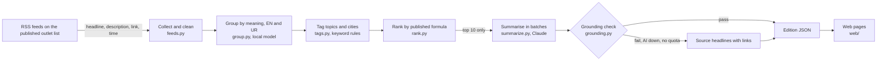

# Design

## Architecture overview

A FastAPI server (`server/app.py`) serves the static site in `web/` and a small JSON API. All AI and all secrets stay on the server.

## Components

| Component | Responsibility | Technology |
|-----------|----------------|------------|
| `server/subah/feeds.py` | Fetch or replay feeds, clean text, drop bad items, de-duplicate, report per feed | feedparser, httpx |
| `server/subah/embed.py` | Sentence embeddings, multilingual, local | fastembed (ONNX) |
| `server/subah/group.py` | Average-link clustering, time window, coverage label | numpy |
| `server/subah/tags.py` | Topic and city tags from English and Urdu keywords; For you tags | regex |
| `server/subah/rank.py` | Mechanical score and top-ten selection | Python |
| `server/subah/summarize.py` | Batched, cached summaries in English and Urdu | Claude API (`anthropic` SDK), structured JSON output |
| `server/subah/grounding.py` | Rejects summaries with numbers or names not in the sources | Python |
| `server/subah/edition.py` | Orchestrates one paper; fallback chain live, snapshot, fixtures | Python |
| `server/app.py` | API and static files; no-cache headers; one generation at a time | FastAPI, uvicorn |
| `web/` | Home, onboarding, paper, last page, gift preview, sources page | HTML, CSS, vanilla JS, GSAP on the home page |

## Data model

- **Article**: id, outlet, feed, language, title, description, link, published time.
- **Story**: articles, distinct outlets, topics and cities (each with the matched word).
- **Edition**: profile (city, topics, language), ten stories (rank, score parts, coverage, For you tags, summary or headline fallback, sources), stats, AI usage, feed report.
- **Reader profile**: kept in the browser only (`localStorage`): masthead name, city, topics, language, large print.

## API / interfaces

| Method | Endpoint | Purpose | Auth required |
|--------|----------|---------|---------------|
| GET | `/api/health` | AI on or off (never the key), grouping model in use | No |
| GET | `/api/outlets` | The published outlet list and the ranking formula | No |
| GET | `/api/catalog` | Topics and cities for the settings form | No |
| POST | `/api/generate` | Generate today's paper now for a test profile `{city, topics, lang}`; optional `source` | No |
| GET | `/api/edition/latest` | The last generated paper | No |

## Key decisions and tradeoffs

| Decision | Options considered | Chosen | Why | Tradeoff accepted |
|----------|--------------------|--------|-----|-------------------|
| Grouping without AI | LLM grouping; embeddings API; local embeddings | Local multilingual embeddings | No quota cost, works when the AI is down, handles Urdu | Model download on first run; quality depends on model size |
| Coverage label | confirmed / single / unconfirmed; outlet count | Outlet count | A count is factual; confirmation is a judgement we cannot make | Readers must interpret the number themselves |
| Outlet definition | Count feeds; count brands | Newsroom brand, language editions once | Prevents one newsroom inflating its own count | BBC News and BBC Urdu count as one |
| Ranking | AI importance; engagement; mechanical | Published formula | Neutral and explainable | Big, widely covered stories dominate |
| Summaries | One call per story; one call per paper; batches | Batches of 5 with a per-story cache | Few calls, one bad batch does not lose the whole paper | Slightly more prompt tokens per call |
| Grounding | Trust the prompt; LLM judge; code check | Code check on numbers and names | Deterministic and testable, no extra AI calls | Strict: some valid summaries fall back to headlines |
| Front end | Next.js; static pages | Static pages served by FastAPI | One process to deploy, works offline with the bundled sample | Less componentised code |

## AI components

- **What AI does:** writes a neutral headline and a one-to-two-sentence summary for each of the ten selected stories, in English and Urdu, using only the headlines and feed descriptions of that story's own reports.
- **What code validates:** JSON schema (structured output); every number and capitalised name present in the sources; cited source ids belong to the story; nothing empty.
- **When AI fails:** no key, rate limit, network error, refusal, cut-off output, invalid JSON, missing story, failed grounding or used-up call budget all lead to the same result for that story: the outlets' own headlines with links. The paper is always produced.
- **Not AI:** grouping, outlet counts, tags, For you, ranking.

## Security and privacy

### Threat model

- Leaking the API key: the key is read only from the server environment (`.env`, git-ignored); `web/` contains no secrets; the API never returns it; static serving is limited to `web/` (tested).
- Prompt injection through feed text: feed text is passed as data in JSON; output is schema-checked and grounding-checked; the model has no tools.
- Abuse of generate-now: one generation at a time (lock); AI calls capped per paper; summaries cached.
- Hostile feed content: HTML stripped, text length capped, links must be http(s), everything escaped before rendering.

### Data handled

Reader settings stay in the browser. The server receives city, topics and language when a paper is generated and does not store them. Test profiles only.

### Known limits

- Grouping quality depends on the embedding model (see testing.md).
- Content licensing with publishers is not yet agreed (README, Known limitations).
