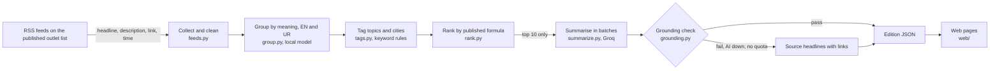

# Design

## Architecture overview

A FastAPI server (`server/app.py`) serves the static site in `web/` and a small JSON API. All AI and all secrets stay on the server.

## Components

| Component | Responsibility | Technology |
|-----------|----------------|------------|
| `server/subah/feeds.py` | Fetch or replay feeds, clean text, drop bad items, de-duplicate, report per feed | feedparser, httpx |
| `server/subah/embed.py` | Sentence embeddings, multilingual, local | fastembed (ONNX) |
| `server/subah/group.py` | Average-link clustering, time window, coverage label | numpy |
| `server/subah/tags.py` | Topic and city tags from English and Urdu keywords; For you tags | regex |
| `server/subah/rank.py` | Mechanical score and top-ten selection | Python |
| `server/subah/summarize.py` | Batched, cached summaries in English and Urdu | Groq chat API (OpenAI-compatible, over httpx), model `openai/gpt-oss-120b`, strict JSON schema output with a plain JSON fallback |
| `server/subah/grounding.py` | Rejects summaries with numbers or names not in the sources | Python |
| `server/subah/edition.py` | Orchestrates one paper; fallback chain live, snapshot, fixtures | Python |
| `server/app.py` | API and static files; no-cache headers; one generation at a time | FastAPI, uvicorn |
| `web/` | Home, onboarding, paper, last page, gift preview, sources page | HTML, CSS, vanilla JS, GSAP on the home page |
| `server/subah/accounts.py` | Sign up, log in, sessions, plans, gift log; MongoDB or in-memory store | pymongo, hashlib.scrypt |
| `server/subah/mailer.py` | Builds the recipient's gift paper from today's edition and sends it through Gmail | smtplib (SMTP over SSL) |
| `web/account.html`, `web/pricing.html` | Log in and sign up, account page, plans and prototype checkout | HTML, CSS, vanilla JS |

## Data model

- **Article**: id, outlet, feed, language, title, description, link, published time.
- **Story**: articles, distinct outlets, topics and cities (each with the matched word).
- **Edition**: profile (city, topics, language), ten stories (rank, score parts, coverage, For you tags, summary or headline fallback, sources), stats, AI usage, feed report.
- **Picks**: the reader's pass, love or keep per story, kept with the edition in the browser; the paper shows loved, then kept, each in formula order.
- **Reader profile**: kept in the browser only (`localStorage`): masthead name, city, topics, language, large print.
- **User** (MongoDB `users`, added after approval): name, email (unique), scrypt password hash, created time, subscription (plan, status, start, renewal, `demo: true`), profile.
- **Session** (`sessions`): SHA-256 hash of a random token, user id, expiry (30 days; MongoDB removes expired sessions). The token itself is only in the reader's HttpOnly cookie.
- **Gift log** (`gifts`): user id, recipient email, time sent, language, city. Used for the monthly allowance.

## API / interfaces

| Method | Endpoint | Purpose | Auth required |
|--------|----------|---------|---------------|
| GET | `/api/health` | AI on or off (never the key), grouping model in use | No |
| GET | `/api/outlets` | The published outlet list and the ranking formula | No |
| GET | `/api/catalog` | Topics and cities for the settings form | No |
| POST | `/api/generate` | Generate today's paper now for a test profile `{city, topics, lang}`; optional `source`, and `pool` (1 to 15 stories, default 10; onboarding asks for 12 so the reader can pick) | No |
| POST | `/api/generate/stream` | Same as generate, streamed as JSON lines: each feed as it answers, then grouping, ranking and summaries, then the edition. Drives the live press-room ticker and the clustering replay | No |
| GET | `/api/edition/latest` | The last generated paper | No |
| GET | `/api/plans` | Basic and Plus, with prices and features | No |
| POST | `/api/auth/signup` | Create an account `{name, email, password}`; sets the session cookie | No |
| POST | `/api/auth/login` | Log in `{email, password}`; sets the session cookie | No |
| POST | `/api/auth/logout` | End the session | Cookie |
| GET | `/api/auth/me` | The logged-in reader's public profile and plan, or `null` | Cookie (optional) |
| POST | `/api/subscribe` | Activate `{plan: basic or plus}` for 30 days (prototype, no payment) | Cookie |
| POST | `/api/subscribe/cancel` | Cancel the plan | Cookie |
| POST | `/api/profile` | Save `{city, topics, lang}` to the account (not yet used by the pages) | Cookie |
| POST | `/api/gift/preview` | The gift email exactly as it would be sent, without sending | No |
| POST | `/api/gift/send` | Email the gift paper; needs a plan and gifts left this month | Cookie |

Every `POST` that changes account state must carry the header `X-Subah: 1` (see Security).

## Key decisions and tradeoffs

| Decision | Options considered | Chosen | Why | Tradeoff accepted |
|----------|--------------------|--------|-----|-------------------|
| Grouping without AI | LLM grouping; embeddings API; local embeddings | Local multilingual embeddings | No quota cost, works when the AI is down, handles Urdu | Model download on first run; quality depends on model size |
| Coverage label | confirmed / single / unconfirmed; outlet count | Outlet count | A count is factual; confirmation is a judgement we cannot make | Readers must interpret the number themselves |
| Outlet definition | Count feeds; count brands | Newsroom brand, language editions once | Prevents one newsroom inflating its own count | BBC News and BBC Urdu count as one |
| Ranking | AI importance; engagement; mechanical | Published formula | Neutral and explainable | Big, widely covered stories dominate |
| Summaries | One call per story; one call per paper; batches | Batches of 5 with a per-story cache | Few calls, one bad batch does not lose the whole paper | Slightly more prompt tokens per call |
| Grounding | Trust the prompt; LLM judge; code check | Code check on numbers and names | Deterministic and testable, no extra AI calls | Strict: some valid summaries fall back to headlines |
| Front end | Next.js; static pages | Static pages served by FastAPI | One process to deploy, works offline with the bundled sample | Less componentised code |
| No-summary stories | Show "no summary"; show headlines only; quote the outlet | One retry with the rejection reasons, then the outlet's own description, credited and linked | The reader always gets a sentence of text, and it is the outlet's words, not ours | A quoted description can be less neutral than a summary |
| Accounts store | SQLite on the Space; MongoDB Atlas | MongoDB Atlas, in-memory when not configured | The Space's disk is wiped on restart; Atlas has a free tier | Needs a network path from the Space to Atlas |
| Passwords and sessions | JWT; server sessions | Server sessions, random token, only its hash stored, HttpOnly cookie | Logging out really ends the session; a leaked database has no usable tokens | One database read per request |
| Payments | Stripe test mode; prototype checkout | Prototype checkout | No payment account was available during the event | Plans are not paid for |
| Email | Gmail API with OAuth; Gmail SMTP with an app password | Gmail SMTP with an app password | No OAuth consent screen to set up; works from the Space | Gmail's daily sending limit; one sender address |
| Read aloud | Text-to-speech API; browser voices | Browser `speechSynthesis` | Free, no key, works offline | Voice quality varies; many devices have no Urdu voice |

## AI components

- **What AI does:** writes a neutral headline and a one-to-two-sentence summary for each of the ten selected stories, in English and Urdu, using only the headlines and feed descriptions of that story's own reports.
- **What code validates:** JSON schema (structured output); every number and capitalised name present in the sources; cited source ids belong to the story; nothing empty.
- **When AI fails:** no key, rate limit, network error, refusal, cut-off output, invalid JSON, missing story, failed grounding or used-up call budget all lead to the same result for that story: the outlets' own headlines with links. The paper is always produced.
- **Not AI:** grouping, outlet counts, tags, For you, ranking.

## Security and privacy

### Threat model

- Leaking the API key: the key is read only from the server environment (`.env`, git-ignored); `web/` contains no secrets; the API never returns it; static serving is limited to `web/` (tested).
- Prompt injection through feed text: feed text is passed as data in JSON; output is schema-checked and grounding-checked; the model has no tools.
- Abuse of generate-now: one generation at a time (lock); AI calls capped per paper; summaries cached.
- Hostile feed content: HTML stripped, text length capped, links must be http(s), everything escaped before rendering.

### Data handled

Reader settings stay in the browser. The server receives city, topics and language when a paper is generated and does not store them. Test profiles only.

### Known limits

- Grouping quality depends on the embedding model (see testing.md).
- Content licensing with publishers is not yet agreed (README, Known limitations).

## Accounts, plans and gift email (added after approval)

### Threat model

- **Stolen passwords from the database:** passwords are stored only as scrypt hashes with a random salt per user.
- **Stolen sessions from the database:** only a SHA-256 hash of each session token is stored, so a copy of the database cannot be used to log in.
- **Session theft in the browser:** the session cookie is HttpOnly (page scripts cannot read it) and Secure on HTTPS. It is SameSite=None on HTTPS so the site also works inside the Hugging Face page.
- **Cross-site requests:** every call that changes account state needs the `X-Subah: 1` header. A form on another site cannot add a header, and a script on another site cannot send one without a CORS preflight, which this server never approves.
- **Password guessing:** after 6 wrong passwords for one email in 15 minutes, logins for that email wait 15 minutes. Wrong email and wrong password give the same message.
- **Email abuse:** sending needs a logged-in account with a plan and is capped at 3 (Basic) or 30 (Plus) emails a month. The email body is built only from today's checked edition; the sender's name and note are HTML-escaped. Replies go to the sender's own address.
- **Secrets:** `MONGODB_URI`, `GMAIL_USER` and `GMAIL_APP_PASSWORD` are read only from the server environment (git-ignored `.env` locally, Space secrets in production) and never returned by the API. Errors name the problem, never the credential.

### Data handled

- For each account: name, email, password hash, plan, and the gift log (recipient email, time, language, city).
- For each gift: the recipient's email address, used to send that one email. Recipients do not get an account.
- Reading settings still stay in the browser unless the account endpoint is used (FR-22).

### Known limits

- Checkout is a prototype: plans are activated without payment.
- Gmail limits one account to about 500 emails a day, and messages from a personal Gmail may land in spam.
- The rate limit on wrong passwords is kept in the server's memory and resets on restart.
